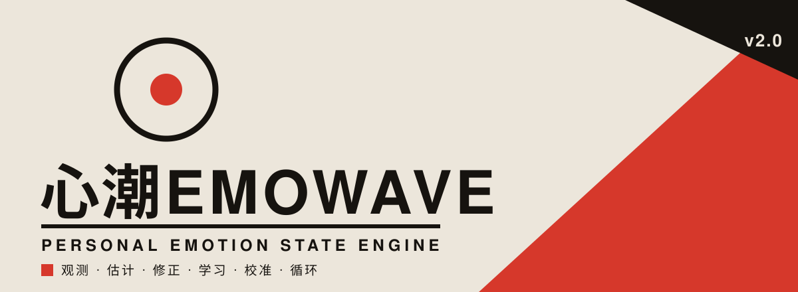

<div align="left">



</div>

# 心潮 EmoWave

> **EmoWave 不替你定义情绪，而是帮你建立一个越来越理解自己的情绪模型。**

`选人群 → 观测 → 估计 → 查看 → 修正 → 学习 → 校准 → 循环`


---

## 01 · 定位

**个人情绪状态引擎**（Personal Emotion State Engine）。维护一条可观察、可编辑、可校准、可学习的连续情绪状态曲线 `E(t) = [V(t), A(t), I(t), S(t)]`，在长期数据积累后形成属于你自己的情绪动态模型。

它**不是**情绪识别器——不武断地告诉你"你现在是什么情绪"。模型永远只是估计，**用户拥有最终解释权**。

**不做什么**：不引入大型本地 LLM 作为运行时依赖；不让 UI / 数据库 / Amiya / 平台实现进入 Core；不训练巨大的情绪识别神经网络；**不在后台常驻运行**（情绪推演只在窗口打开时按前台心跳推进）。

---

## 02 · 精力人群先验与情绪波（v3 交互主线）

**开局选一类人群，得到一条默认曲线；记录一次情绪，画出一个会自己收回基线的"波"。**

**三类精力人群先验**（`emowave/core/domain/archetype.py`）——把人群按精力分为高 / 中 / 低，各配一条默认曲线函数（Matérn GP 的 `ℓ 惯性 · σ 幅度 · 基线中心`）。精力≈唤醒：

| 人群 | 基线唤醒 | σ 幅度 | ℓ 惯性 | 直观感受 |
|---|---|---|---|---|
| 高精力 | 高（0.60） | 大 | 短（180/240s） | 起得快、落得也快 |
| 中精力 | 中（0.42，=群体先验） | 中 | 中（240/300s） | 默认 |
| 低精力 | 低（0.25） | 小 | 长（320/380s） | 更平、更缓 |

**情绪波生命周期**（主界面曲线，非开机常驻）：

```
idle（开始记录） → recording（1Hz 采样记录中）
   → 停止 → decaying（按模型惯性向基线外推衰减，实时"慢慢推演"）
   → 回归基线平稳 → 曲线消失 → idle（等待下一次记录）
```

- 停止记录后曲线不清空，而是**向基线（一开始的平均值）外推衰减**，回归平稳即消失——一次记录=一个情绪事件。
- **无后台进程**：衰减只在窗口打开时由前台 1Hz 心跳推进；关闭时把未走完的波存进本地库，**下次启动自动重放推演**。
- 附带性质：高精力一波回归更快、低精力更慢（与人群先验自洽）。
- 个性化学习**向所选人群的先验收缩**（不再是单一全局先验）——换人群，学习回归的目标也随之改变。

---

## 03 · 四层架构

```
┌─────────────────────────────────────────────────────────────┐
│  L4  主权层   基线制度 nudge / fork / reset                  │
│               BOCPD 提议 → 用户裁决 → 反哺检测器阈值         │
├─────────────────────────────────────────────────────────────┤
│  L3  学习层   边际似然 + 层次先验收缩 → 个人超参数 θ         │
│               收缩锚 = 所选精力人群先验（非单一全局先验）    │
│               Coactive Learning：拖动当"改进"而非"真值"      │
├─────────────────────────────────────────────────────────────┤
│  L2  回顾层   RTS 平滑（非因果 · O(N) · 全局）              │
│               均值曲线 μ(t) + 置信带 σ(t) + 可拖拽控制点     │
├─────────────────────────────────────────────────────────────┤
│  L1  感知层   因果 Kalman（Matérn ν=3/2 状态空间）          │
│               起点 = 所选人群先验 · <0.15ms/步 · O(1) 内存   │
└─────────────────────────────────────────────────────────────┘
```

**核心不变量**：L1 因果滤波在任何设备档位都保留——情绪追踪的核心体验在一切设备上一致。L2/L3/L4 按 Tier 优雅降级。

---

## 04 · 内核地图

```
emowave/                          零第三方依赖 · 纯标准库 · pip 可安装
│
├─ core/
│  ├─ domain/        Observation · EmotionState · UserCorrection
│  │                 Baseline · ModelParameters · StateEvent    （全 frozen）
│  │                 archetype.py  高/中/低精力人群先验（默认曲线函数）
│  ├─ estimator/     Matérn ν=3/2 状态空间 Kalman（L1）
│  ├─ curve/         RTS 平滑 + 可编辑曲线 + 节点网格（L2）
│  ├─ calibration/   在线岭回归 · 个人超参（锚=人群先验） · 基线主权（L3+L4）
│  ├─ inference/     个人动态模型 · 趋势预测 + uncertainty
│  ├─ protocol/      Envelope · Amiya 输入输出 · 三版本号
│  ├─ linalg.py      纯标准库矩阵（n×n 求逆，替换 numpy）
│  └─ tier.py        能力分档 T0/T1/T2（低配优雅降级）
│
├─ adapters/         agent/amiya.py（集成桥）· storage/sqlite.py（七表）
└─ cli/              demo · detect · curve · version（Core 脱离 UI 运行）
```

**Core 硬边界**：Core 不知道 PyQt / Flet / Android / iOS / SQLite 实现细节 / Amiya / LLM / TTS。所有跨边界交互经 `adapters/`。

---

## UI 预览（v3.1 小窗化实拍 · PyQt5 桌面端）

> **400×680 手机比例小窗**（最小 360×600，单列布局）：**页头 44px**（标题 + 日期 + 精力·X ▾ + 导出/关于）→ **顶部 Tab 栏 40px**（曲线 / 模型 / 历史）→ 曲线页 = **状态头**（状态名 + 效价/唤醒/置信/区间四读数）+ **曲线**（视觉主角，最小 340px）+ **输入台**（双滑块 + 开始/停止记录）。模型页 = 基线主权 + 个人模型 + 参数说明；历史页 = 事件回顾 + 历史记录。开局弹出"选精力人群"，页头可随时重选。
> 构成主义骨架（大块面 · 不对称 · 硬边直角 · 粗无衬线）+ 暖色板（暖黄纸底 · 陶土赟红 · 低饱和 · 单一色相）

| 01 · 主界面 | 02 · 模型页 | 03 · 历史页 | 04 · 纠正框（400×480） |
|:---:|:---:|:---:|:---:|
| [主界面](docs/screenshots/01-main.png) | [模型页](docs/screenshots/02-model.png) | [历史页](docs/screenshots/03-history.png) | [纠正框](docs/screenshots/04-correct-sheet.png) |

> 调研依据：[`docs/UI_PREFLIGHT_视觉传达与UI设计调研.md`](docs/UI_PREFLIGHT_视觉传达与UI设计调研.md) · 设计令牌：[`theme.py`](theme.py)
> 小窗化重构（阶段 0～5，含读码报告 / 检索台账 / 方案）：[`docs/ui-compact-refactor/`](docs/ui-compact-refactor/)

**v5 视觉验收（2026-10-21 · Windows 实拍）**：

| 主界面 400×680 | 最小窗 360×600 | 悬浮窗（展开） | 空态 |
|:---:|:---:|:---:|:---:|
| [`v5-main-400x680.png`](docs/screenshots/v5-main-400x680.png) | [`v5-main-360x600.png`](docs/screenshots/v5-main-360x600.png) | [`v5-mini-expanded.png`](docs/screenshots/v5-mini-expanded.png) | [`v5-empty.png`](docs/screenshots/v5-empty.png) |

| 模型页 | 历史页 | 错误态 | 悬停读数 |
|:---:|:---:|:---:|:---:|
| [`v5-model-400x680.png`](docs/screenshots/v5-model-400x680.png) | [`v5-history-400x680.png`](docs/screenshots/v5-history-400x680.png) | [`v5-notice.png`](docs/screenshots/v5-notice.png) | [`v5-hover.png`](docs/screenshots/v5-hover.png) |

**桌面端结构**（PyQt5，与内核解耦，`emowave/` 不反向依赖任何 UI 代码）：

```
main_app.py            外壳 · 页头(44px) + 顶部 Tab 栏(40px，曲线/模型/历史三页) · 窗口 400×680 · HighDPI 在 QApplication 构造前 setAttribute
│                     开局选精力人群 + 页头"精力·X ▾"随时重选
├─ theme.py            设计令牌 + 一份 app 级 QSS（修 QSS 不继承 font/color）
├─ curve_widget.py     曲线 · 双序列 · 单次描边 · 时间轴按跨度自适应（短记录显示到秒）
└─ windows/
   ├─ top_tabs.py          顶部分段 Tab（当前页底部 2px accent 硬边条）——取代 v3 的 56px 图标列
   ├─ state_head.py        状态头（状态名 + 四读数）+ 参数说明卡
   ├─ main_console.py      三页主界面 + 情绪波生命周期（记录→衰减回基线→消失）
   ├─ archetype_dialog.py  开局/重选"高·中·低精力"人群
   ├─ baseline_tools.py    基线主权：步进 ±0.02 · ♦ 分叉 · ↺ 重置
   ├─ model_card.py        个人模型：学习进度 · 惯性 ℓ · 阶段
   ├─ legacy_embed.py      事件回顾 · 历史记录（注入 db，可刷新）
   ├─ event_detail_dialog.py 补全/修正事件：触发·躯体·应对·自评
   └─ correction_sheet.py + correction_canvas.py   上滑纠正框（400×480，双曲线拖点 + 手动输入）
```


**这一路修掉的关键问题**：

| 问题 | 根因 | 修法 |
|---|---|---|
| 侧栏两个按钮点不进去 | 曲线按钮未接 `clicked`；`setFixedWidth` 钉死 `minimumWidth` 使抽屉收放动画失效 | 接处理 + 抽屉 `minimumWidth=0` + 内层固定宽容器 |
| 事件回顾/历史永远空壳 | `session=None` 未注入 + 从不 `refresh` + v3 记录从不写事件表 | 注入 db + 开抽屉/停记录刷新 + 停止记录聚合落库 |
| 时间轴看着卡死 | 刻度只到分钟，短记录三刻度同值 | 按可见跨度自适应（短→显示到秒）+ 多刻度 |
| 抽屉底部内容够不着 | 无滚动条，内容高于视口被裁 | 抽屉 body 包 `QScrollArea` |
| 改点不重拟合曲线 | 界面画因果 Kalman，纠正只入队 | 显示曲线改 RTS 平滑，纠正作伪观察即时重拟合 |
| 1px 发丝线糊 / 廉价感 / 拐点串珠 | HighDPI 未前置 / 逐控件 QSS / 逐段 drawLine | 前置 HighDPI + 一份 app 级 QSS + 单次 `QPainterPath` |

实测 n=20000 平滑数据单次渲染 **14.7 ms**（目标 ≤149 ms）。

---

## 05 · 关键算法

**Matérn ν=3/2 状态空间**（Hartikainen & Särkkä 2010）——Kalman 是计算后端，高斯过程是数学语义，二者精确等价，复杂度 O(N) 而非 GP 的 O(N³)。

```
λ = √3 / ℓ
F(Δt) = e^(−λΔt) · [ 1+λΔt    Δt   ]
                    [ −λ²Δt   1−λΔt ]
P∞ = σ² · [1  0  ]      Q(Δt) = P∞ − F·P∞·Fᵀ
          [0  λ² ]
```

`ℓ` 即**情绪惯性**（Kuppens 2010）——一个有心理学含义的可学习参数。恢复半衰期 `t½ ≈ 0.969·ℓ`。

**情绪波衰减回基线**：停止记录后，位置按 Matérn 衰减因子 `d(Δt)=e^(−λΔt)(1+λΔt)` 在**偏离空间**向基线（GP 均值函数）外推——注意不是向 0 收，所以曲线收回的是"你的正常值"。

**其余支柱**：RTS 非因果平滑（拖动一点、整条曲线光滑变形）· 峰终加权（Kahneman 1993）· 层次先验收缩（Taylor 2017，**锚点=所选人群先验**）· Coactive 有界更新（Shivaswamy & Joachims 2015）· 在线岭回归（补偿系统性残差）。

---

## 06 · 安全与隐私

情绪数据属**高敏感个人状态数据**，默认 **Local-first**。

| 维度 | 保证 |
|---|---|
| 原始数据不可变 | `frozen` dataclass + SQLite `BEFORE UPDATE/DELETE` 触发器**双层强制** |
| 模型结果可重算 | `EmotionState` 可由 `(observations + params)` 完全重建 |
| 用户修正永久保留 | correction append-only，是个人模型的监督信号 |
| SQL 注入 | 全参数化查询（`?` 占位）；补全事件的 `update_event` 仅拼白名单列名 |
| 敏感信息 | 内核零硬编码密钥；日志**不泄露**用户文本与情绪数值 |
| 危险调用 | 无 `eval` / `exec` / `os.system` / `pickle` / `shell=True` |
| 跨线程 | SQLite 连接读写全部串行化（`RLock` + `busy_timeout`） |
| 数据主权 | 用户拥有导出 / 删除 / 重置；可关闭 EmoWave→Amiya 共享 |

> 经 `diegosouzapw-analyze-code` 独立审查 + 两轮 `p3c-code-quality`（按 Python 适配）：无 CRITICAL，核心数学逐行核对正确；已修 NaN/Inf 硬化、SQLite 线程安全、空 catch 改日志等。详见 [`docs/history/refactor-progress.md`](docs/history/refactor-progress.md) 与 [`docs/测试报告/`](docs/测试报告/)。

---

## 07 · 优雅降级

**任何可选能力都必须能够失效而不摧毁核心系统。**

```
EmoWave without Amiya   ✅   内核完整独立运行
Amiya without EmoWave   ✅   回退关键词规则分类
EmoWave + Amiya         ✅   连续模型推断，下游零改动
无 PyQt5 / 无本地库     ✅   核心引擎与 CLI 照常运行；主界面可脱库启动
```

四级降级：L0 启动期未安装静默回退 · L1 配置期 `EMOWAVE_ENABLED=0` 默认关闭 · L2 运行期异常捕获回退绝不上抛 · L3 能力期低配/省电按 Tier 降档。

---

## 08 · 性能

低配置电脑和手机也能实时运行。纯 Python 内核实测：

| 指标 | 实测 | 目标 |
|---|---:|---:|
| L1 因果滤波单步 | **0.148 ms** | < 20 ms |
| L1 @ 1Hz CPU 占用 | **0.015 %** | — |
| RTS 节点网格降采样 | **6.1× 加速** | part2 §2.4 |
| 曲线重建（T1 档） | **149 ms** | ≤ 150 ms |
| GPU 依赖 | **无** | 不要求 |

RMSE 对照：新 Matérn 估计器全局优于旧 Kalman（0.053 vs 0.065），**观测缺失区域改善 27.2%**。

---

## 09 · 快速开始

**作为 pip 包安装内核（零依赖）：**

```bash
pip install emowave                      # 或从 Release 下载 emowave-3.0.0-py3-none-any.whl
emowave version                          # 版本 + 协议 schema + 探测档位
emowave demo --points 60                 # 合成观察流 → 实时状态估计
emowave detect --text "我好焦虑"
emowave curve --points 60 --nodes 15     # RTS 曲线 + 置信带
```

**桌面 GUI（PyQt5 5.15+，可选）：**

```bash
pip install "emowave[gui]"               # 或 pip install PyQt5
python main_app.py                       # 源码运行；Windows 可双击 run_emowave.bat
```

```python
from emowave import Observation, get_archetype
from emowave.core.estimator.estimator import StateEstimator

prior = get_archetype("high")            # 选一类精力人群先验作起点
est = StateEstimator(params=prior.to_params(), baseline=prior.to_baseline())
est.initialize(timestamp=1000.0, valence=0.5, arousal=0.5)
for i in range(60):
    state = est.update(Observation(timestamp=1000.0 + i, valence=0.6, arousal=0.4))
    # state.valence · state.arousal · state.intensity · state.confidence · state.trend
```

---

## 10 · 测试与质量

**763 个测试全通过**（内核 `emowave/tests/` 593 + 桌面端 `tests/` 170），TDD 全程：写测试 → 看失败 → 最小实现 → 看通过 → 重构。其中 6 条是**架构护栏**（零依赖内核 / 无孤儿模块 / 入口可 import / 白名单防腐 / 代码体积预算 / 无重复定义）。

```bash
python -m pytest emowave/tests/ -v       # 593 内核测试
python -m pytest tests/ -v               # 170 桌面端集成 + 架构护栏
```

覆盖：领域模型不变式 · Matérn 闭式解数学性质 · RTS 优于滤波 · 可编辑曲线不发散 · 精力人群先验与锚点收缩 · 情绪波衰减回基线 · 事件落库与补全 · 基线主权 · 双向降级 · SQLite 不可变与并发 · CLI。

### v4 · 时间语义（2026-10）

这一轮不改数学，只把「什么是真实观察、什么算现在、什么只是预测」理清：

| 以前 | 现在 |
|---|---|
| 记录期间 1Hz 定时器每秒读滑条 → 同一值复制成几百条「观察」 | 观察只由用户动作产生（拖动防抖 350ms 合成一条 / 「记一笔」显式确认） |
| 模型时间 = 定时器触发次数 × 1 秒 | 模型时间 = 墙钟差；关机/休眠期间的时间不再丢失 |
| 波结束 → 清空观察并重建估计器 | 波结束只结束**动画**；`latest_state` 常驻并落盘，重启后按真实时间推进 |
| 关主窗 = 进程退出（挂件不可能常驻） | 挂件可见时关主窗只隐藏；挂件右键「退出程序」是显式出口 |
| 长时间无观察时状态掉向 0 | 回到**用户基线**（与曲线尾巴同一套语义） |
| 预测点和真实历史画得一模一样 | 越过最后一次自评的部分画**虚线** |

配套的内核改动很小：`StateEstimator.advance_to()`（无观察推进）与
`predict_step()`（单步原语，`predict_forward` 改为循环调用它，输出逐位一致）。
过程与实测数据见 [`docs/refactor-v4/`](docs/refactor-v4/)。

### v5 · 数据契约 + UI（2026-10）

Phase 0–5 完成：单轨时间（读数与曲线同源）、纠正持久化、首屏 meta 行、悬浮窗收起/展开/钉住、四类曲线语义、字体层级修复、柔和圆角、空态/错误态、360×600 适配、曲线悬停、视图不再读 presenter 私有成员。测试 **763 passed**，行数 25,107 / 27,000。

- 路线图与阶段交接：[`docs/refactor-v5/ROADMAP.md`](docs/refactor-v5/ROADMAP.md)
- 视觉验收（Windows 实拍）：[`v5-main-400x680.png`](docs/screenshots/v5-main-400x680.png) · [`v5-main-360x600.png`](docs/screenshots/v5-main-360x600.png) · [`v5-mini-expanded.png`](docs/screenshots/v5-mini-expanded.png)
- Phase 6（预测日志 + MAE/RMSE + 7 天真实使用）待开始。

---

## 11 · 与 Amiya 的关系

```
EmoWave = State Engine      "用户现在大概处于什么状态？"
Amiya   = Companion Agent   "我应该怎样理解、回应和陪伴？"
```

EmoWave 作为 Amiya 的**可选外部状态引擎**，不反向依赖 Amiya。Amiya 侧只需 `from emowave import EmotionBridge`，即可从"关键词猜"升级为"连续效价-唤醒模型推断"，下游提示词注入 / 皮肤联动零改动。

---

## 12 · 版本与许可

- **v5.0.0（开发中，未打 tag）**：数据契约 + UI 重构 —— Phase 0–5 完成（单轨时间、纠正持久化、首屏 meta、悬浮窗、视觉/错误态/悬停/缩放）；Phase 6 预测日志与评估底座待开始。内核 pip 包版本仍为 **3.0.0**。
- **v4.0.0（已完成，未打 tag）**：时间语义重构 —— 观察只由用户动作产生、模型时间跟墙钟、状态常驻与挂件常驻、5 分钟低频刷新、预测段虚线、恢复加固。内核 pip 包版本仍为 **3.0.0**（本轮对其只有增量 API + 一处行为修正，未破坏公开签名）。
- **v3.0.0**：PyQt5 桌面端成型 —— 精力人群先验、情绪波生命周期、事件补全窗口、人群锚定的个性化学习、内核 pip 包 + GitHub Release。下载见 [Releases](https://github.com/x7687315-gif/emowave-engine/releases/tag/v3.0.0)。
- 内核 2.0 重构 Phase 0–9 已完成并并入 `main`；1.x 稳定版锚定 tag **`v1.0-stable`**，随时可回退。
- 功能分支均已合并回 `main` 并清理。

**MIT** · 接手/维护请先读 [`docs/交接文档.md`](docs/交接文档.md) 与 [`docs/refactor-v5/ROADMAP.md`](docs/refactor-v5/ROADMAP.md)；架构见 [`docs/architecture/`](docs/architecture/)（情绪模型 / 轻量内核 / 移动端），重构执行日志见 [`docs/history/refactor-progress.md`](docs/history/refactor-progress.md)。

**2026-10 瘦身**：清除 1.x 引擎栈与研究脚手架，代码 41k → 21.9k 行（−47%），仓库 22MB → 7.8MB，依赖仅剩 `PyQt5`（内核仍零依赖）。过程与证据见 [`docs/slim-refactor/`](docs/slim-refactor/)。

---

■ 心潮 EmoWave · Personal Emotion State Engine · v5.0.0 · Core 3.0.0
