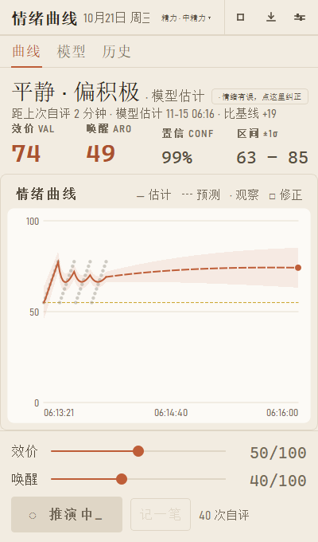
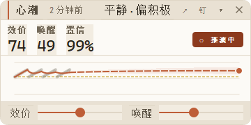
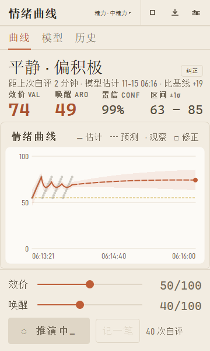
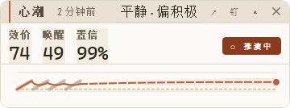
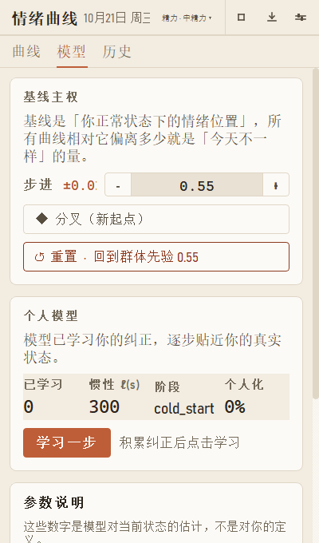
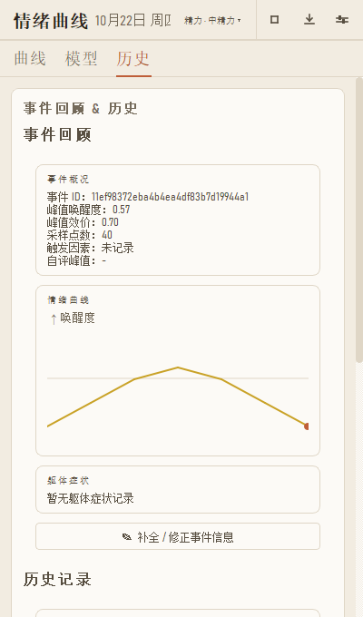
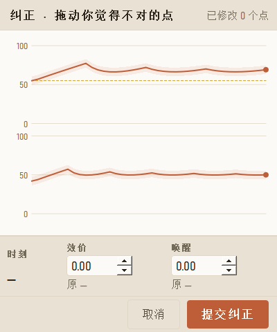
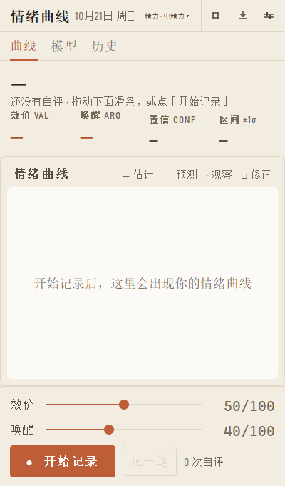
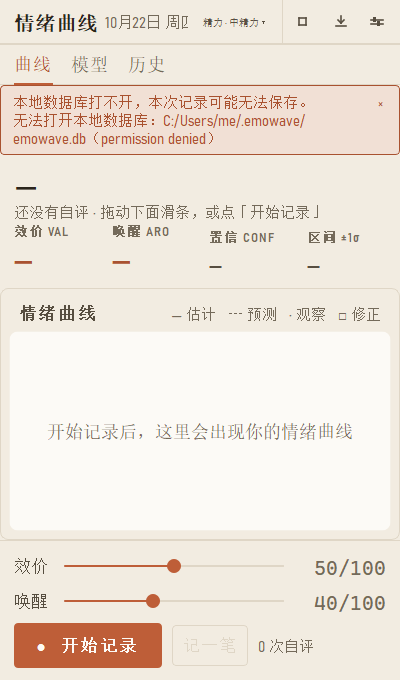
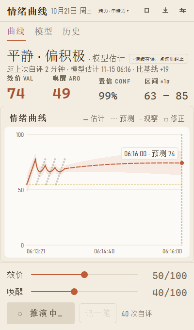

<div align="center">


# 心潮 EmoWave

**个人情绪状态引擎** · Personal Emotion State Engine

> EmoWave 不替你定义情绪，而是帮你建立一个越来越理解自己的情绪模型。

[](docs/refactor-v5/05-阶段5-视觉系统与交互验收.md)
[](emowave/)
[](pyproject.toml)
[](docs/refactor-v5/ROADMAP.md)
[](run_emowave.bat)
[](LICENSE)

[快速开始](#快速开始) · [功能详解](#功能详解) · [真实界面](#真实界面) · [架构](#架构与代码地图) · [状态与路线图](#项目状态与路线图) · [文档地图](#文档地图)

</div>

---

## 这是什么

**EmoWave 是一个本地优先的个人情绪状态引擎。**

它维护一条连续、可观察、可编辑、可校准、可学习的情绪状态曲线：

```
E(t) = [V(t), A(t), I(t), S(t)]
        效价   唤醒   强度   趋势
```

你不需要每天填长问卷，也不需要让系统“识别”你的表情或文字。你只需要在想起来的时候，拖一下滑条、点一下「记一笔」，或者事后拖动曲线纠正一个点。EmoWave 会把这些真实自评放进一个带时间语义的模型里，估计你现在大概处于什么状态，并给出一个会随时间衰减、越远越不确定的未来预测。

它想回答的不是“你是什么情绪”，而是三个更实际的问题：

1. **现在大概是什么状态？** 效价、唤醒、置信度、与个人基线的差。
2. **最近发生了什么？** 一条能区分“我说的 / 模型算的 / 猜的 / 我改的”的曲线。
3. **我的情绪通常怎么变化？** 在长期记录后，形成一个属于你自己的情绪动态模型。

### 它不是什么

| 不是 | 原因 |
|---|---|
| 不是情绪识别器 | 不根据表情、键盘、文本武断地给你贴标签；模型永远只是估计，**你拥有最终解释权** |
| 不是医疗/心理诊断工具 | 不提供诊断、治疗或危机干预建议；如有需要请联系专业人士 |
| 不是云端服务 | 默认只写本机 SQLite，不上传情绪数据，不需要账号 |
| 不是大模型应用 | 运行时不需要 LLM；内核是纯 Python 标准库 |
| 不是后台常驻程序 | 情绪推演只在窗口打开时由前台心跳推进；关掉程序就停止 |
| 不是“更准的预测器” | 目前只证明了**语义正确、数据链路可靠**；模型精度仍待真实数据评估 |

### 适合谁

- 想持续观察自己情绪变化，但不想每天写长篇日记的人；
- 喜欢“可解释、可修正、可自己掌控数据”的工具的人；
- 想研究或复用一套零依赖情绪状态内核的开发者；
- 需要给陪伴型 Agent 提供连续状态输入，而不是关键词分类的开发者。

---

## 真实界面

> 以下均为 **Windows 上真实运行的 PyQt5 界面截图**；曲线、事件与时间戳为演示数据，不是真实用户数据。
> 截图使用当前时间生成，主窗 400×680，悬浮窗 360×180。

### 主界面与悬浮窗

| 主界面 · 400×680 | 悬浮窗 · 展开 |
|:---:|:---:|
|  |  |
| 状态头、曲线、输入台三块；四类曲线语义一眼可分 | 桌面快速查看：状态、读数、迷你曲线、快速记录 |

| 最小窗 · 360×600 | 悬浮窗 · 收起 |
|:---:|:---:|
|  |  |
| 日期让位、提示语收起，曲线与输入台仍完整 | 只藏滑条，状态/曲线/记录按钮都保留；收起不等于暂停 |

### 模型、历史与纠正

| 模型页 | 历史页 | 纠正框 |
|:---:|:---:|:---:|
|  |  |  |
| 基线主权、个人模型、参数说明（2×2） | 事件回顾、事件补全、历史记录 | 拖动曲线或手动输入；显示修正与学习两套权重 |

### 空态、错误态与悬停

| 空态 | 错误态 | 悬停读数 |
|:---:|:---:|:---:|
|  |  |  |
| 第一次打开：告诉你能做什么，不显示假曲线 | 数据库/快照/写入失败：可关闭提示条，不静默 | 时间 + 语义 + 数值；预测段标“预测” |

> 截图来自 v5 当前界面（2026-10-22）；设计令牌在 [`theme.py`](theme.py)，视觉调研在 [`docs/UI_PREFLIGHT_视觉传达与UI设计调研.md`](docs/UI_PREFLIGHT_视觉传达与UI设计调研.md)。

---

## 你可以用它做什么

### 日常：记一次，看一眼

1. 打开主界面或悬浮窗；
2. 拖效价 / 唤醒滑条，或点「记一笔」；
3. 看一眼状态头：现在大概是什么状态、离上次自评多久、比基线高多少；
4. 关掉主窗，让悬浮窗留在桌面角落；需要时移入展开、快速记一笔。

### 一周：看模式，而不是看单个数字

- 曲线会区分 **真实观察 / 模型估计 / 未来预测 / 用户修正**；
- 悬停能看到某个时刻的值和它的语义；
- 历史页能回看事件、补全触发/躯体/应对信息；
- 模型页能看到学习进度、情绪惯性 ℓ、基线。

### 长期：让模型更像你

- 在纠正框里拖动“你觉得不对”的点；
- 每次停止记录后自动学习一步；
- 基线可以 nudge / fork / reset；
- 换精力人群先验，观察模型如何重新收缩。

### 研究/开发：把内核拿出来用

```python
from emowave import Observation, get_archetype
from emowave.core.estimator.estimator import StateEstimator

prior = get_archetype("high")
est = StateEstimator(params=prior.to_params(), baseline=prior.to_baseline())
est.initialize(timestamp=1000.0, valence=0.5, arousal=0.5)
for i in range(60):
    state = est.update(Observation(timestamp=1000.0 + i,
                                   valence=0.6, arousal=0.4))
    # state.valence / state.arousal / state.confidence / state.trend
```

内核不需要 PyQt、SQLite 或任何第三方包；可以直接嵌进桌面端、移动端或 Agent。

---

## 功能详解

### 1. 选一类精力人群，先得到一条“正常曲线”

首次启动会让你选择高 / 中 / 低精力人群。它不是给你贴人格标签，而是给模型一个**起点先验**：

| 人群 | 基线唤醒 | σ 幅度 | ℓ 惯性 | 直观感受 |
|---|---:|---:|---|---|
| 高精力 | 0.60 | 大 | 短（180/240s） | 起得快、落得也快 |
| 中精力 | 0.42（群体先验） | 中 | 中（240/300s） | 默认 |
| 低精力 | 0.25 | 小 | 长（320/380s） | 更平、更缓 |

- 先验同时决定模型的默认曲线和**个性化学习的收缩锚点**；
- 页头「精力 · X ▾」可以随时重选；
- 重选会重建估计器、校准器和基线，并清空当前会话曲线（历史数据仍在）。

### 2. 记录一次情绪：一次动作 = 一条观察

这是 v4 最重要的语义修正。

| 以前 | 现在 |
|---|---|
| 记录期间 1Hz 定时器每秒读滑条，把同一个值复制成几百条“观察” | **观察只由用户动作产生**：拖动防抖 350ms 合成一条；「记一笔」显式确认 |
| 模型时间 = 定时器触发次数 × 1 秒 | 模型时间 = 墙钟差；关机/休眠的时间不会被吞掉 |
| 波结束清空观察、重建估计器 | 波结束只结束**动画**；`latest_state` 常驻并落盘 |
| 关主窗 = 退出 | 挂件可见时关主窗只隐藏；真正退出在挂件右键菜单 |

具体行为：

- **开始记录**：进入记录态，1Hz 心跳只推进“现在”，不制造自评；
- **拖动滑条**：`ObservationRecorder` 防抖；停止拖动 350ms 后提交一条；
- **记一笔**：立即把当前滑条值提交为一条真实自评，即使值和上一条相同；
- **停止记录**：保留本次观察与曲线，进入“衰减回基线”，回归后曲线消失；
- **快捷键**：`Ctrl+R` 开始/停止记录，`Ctrl+N` 记一笔；
- **一次拖动只产生 1 条自评**，有回归测试守着。

情绪波的完整生命周期：

```
idle（开始记录） → recording（1Hz 心跳只推进时间）
   → 停止 → decaying（按模型惯性向基线外推，实时推演）
   → 回归基线平稳 → 曲线消失 → idle
```

> 停下来的曲线不是“消失”，而是**收回到你的基线**——不是收到 0，也不是收到“平均人”。
> 一次记录 = 一个情绪事件；事件会落库，状态会常驻。

### 3. 状态头：这个数是几点的？

主界面的状态头不只是四个数字：

```
平静 · 偏积极   · 模型估计   [纠正]
距上次自评 2 分钟 · 模型估计 16:54 · 比基线 +19
效价 74   唤醒 49   置信 99%   区间 63 – 85
```

- **距上次自评**：`state_ts - last_obs_ts`；小于 60 秒显示“刚刚自评”；
- **模型估计时刻**：`state_ts`；只在模型比自评新时显示；
- **与基线差**：≤2 说“与基线持平”，避免把 ±1 的噪声当趋势；
- **空态**：没有数据时显示“还没有自评 · 拖动下面滑条，或点「开始记录」”，不显示假曲线；
- **窄屏**：360px 时隐藏“· 模型估计”并收成「纠正」，日期让位。

### 4. 曲线：四种东西不是一回事

曲线是整个应用信息密度最高的地方。EmoWave 用**形状**而不是只靠颜色区分四类数据：

| 元素 | 画法 | 含义 |
|---|---|---|
| 真实观察 | 实心小圆（弱） | 我说的 |
| 模型估计 | 实线 + ±1σ 置信带 | 模型算的 |
| 未来预测 | 虚线，与实线相接 | 猜的 |
| 用户修正 | 空心方框 | 我改的 |
| 个人基线 | 细虚线 | 我的正常值 |

其他细节：

- 历史曲线用 **RTS 非因果平滑**：拖动一个点，整条历史曲线平滑变形；
- 预测尾巴用 **因果 `predict_forward`**：只使用当下可得的状态，方差随 horizon 增长；
- 时间轴按可见跨度自适应：短记录显示到秒，跨天带日期；
- 悬停显示时间 + 语义 + 数值；附近有原始观察/修正时一起显示；
- 静态层（网格/刻度/标签）有 pixmap 缓存，数据变化只重画数据层；
- 数据点超过阈值会等间隔抽稀，每个像素最多一个点。

> ±1σ 带表示**模型不确定性**，不是经过校准的统计置信度。它的意义是“越远越不确定”，不是“95% 概率”。

### 5. 修正与学习：拖动不是改数据，是告诉模型你的判断

- 曲线上的「情绪有误，点这里纠正」打开纠正框；
- 可以拖动双曲线上的点，也可以在底部手动输入效价/唤醒；
- 提交后：
  - **显示层**用固定高权重（1.0）立即重拟合，让曲线跟手；
  - **学习层**仍用 `UserCorrection.reliability_weight`（拖拽约 0.36）保守更新，避免一次拖动过拟合；
  - 修正写入 `app_state`，**重启后仍在**；
  - 重启时回灌 `calibrator`，学习不因关窗归零；
  - 不把旧波修正塞进新波，避免上一波的点画到这一波上。
- 停止记录时会自动学习一步；模型页也能手动「学习一步」。

### 6. 基线主权：你的正常值由你决定

“基线”不是全局常数，而是**你的正常状态位置**。模型在偏离空间里工作：情绪偏离基线多少，才是“今天不一样”的量。

模型页提供三种操作：

- **步进 ±0.02**：快速微调；
- **分叉（新起点）**：把当前值作为一个新的 regime；
- **重置**：回到所选人群的群体先验。

学习会向所选人群的先验收缩；换人群，收缩目标随之改变。

### 7. 主窗与悬浮窗：两套界面，同一个模型

**主窗口（400×680，最小 360×600）**

- 页头：标题、日期、精力人群、迷你挂件开关、导出、关于；
- 顶部 Tab：曲线 / 模型 / 历史；
- 曲线页：状态头 + 曲线 + 输入台；
- 模型页：基线主权 + 个人模型 + 参数说明；
- 历史页：事件回顾 + 事件补全 + 历史记录。

**悬浮窗（360×180，收起 134）**

- 始终置顶、不进任务栏、无边框可拖动；
- 头部：距上次自评、状态名、打开主窗、钉住、展开/收起、关闭；
- 读数：效价 / 唤醒 / 置信；
- 迷你曲线（sparkline，不显示刻度）；
- 记录 / 记一笔 / 双滑条；
- 与主窗**共用同一个 `ConsolePresenter`**，不复制模型；
- 悬停展开、移出收起（未钉住时）；开始记录强制展开；
- **收起 ≠ 暂停**：窗口形态与模型推进解耦；
- 挂件可见时开启 5 分钟低频刷新；隐藏时停止定时器，下次显示补时间差。

> 主窗与挂件的数字由同一份 payload 驱动；有测试逐字符比对。

### 8. 关闭、重启、休眠：状态不会凭空消失

- 数据落在 `~/.emowave/emowave.db`（Windows: `%USERPROFILE%\.emowave\emowave.db`）；
- 停止记录时把未走完的波存快照；重启后按**真实墙钟**续算：
  - 关机 60 秒：曲线继续推演；
  - 关机 30 分钟：波自然结束，但状态仍在；
- 快照损坏不会让启动崩溃：整体丢弃损坏快照，保留已落库事件；
- 恢复幂等：重复调用不会把同一批观察插两遍；
- 快照带 schema 版本，兼容 v1 的 `end_ts` 旧格式；
- 最近事件的 `raw_data` 也可以用来重建“现在”的状态，但不会把历史曲线画出来。

### 9. 错误态：坏库、坏快照、写失败都不静默

| 场景 | 行为 |
|---|---|
| 数据库打不开 | 打开后 `PRAGMA quick_check`；失败抛 `DatabaseOpenError`（带路径）；主窗降级为无库启动并显示可关闭提示条 |
| 快照损坏 | `active_wave` / `latest_state` / `corrections` 损坏时提示“哪份数据、什么影响”，同类只提示一次 |
| 事件保存失败 | 尝试把事件写到 `~/.emowave/pending/<event_id>.json` 恢复文件，并在提示条给出路径 |
| 空数据 | 显示下一步操作，不显示假曲线 |
| 无 PyQt5 / 无本地库 | 内核与 CLI 照常运行；主界面可脱库启动 |

### 10. 预测日志与评估：把“准不准”变成可验证的问题

曲线好看不等于模型准。EmoWave 在 Phase 6 增加了：

- **`forecast_log`**：在每个预测时点记录 `base_ts / target_ts / horizon / valence / arousal / 方差 / source`；
- **因果预测**：用 `predict_forward`，不使用 RTS 平滑曲线倒推“当时预测”；
- **节流**：新观察强制留一份；衰减/刷新最多 60 秒一份；预测绝不进入观察；
- **离线评估**：`python -m tools.forecast_eval` 从事件 `raw_data` 与 `active_wave` 还原观察，按 horizon 分组输出 MAE / RMSE / 样本数。

7 天真实使用清单、解读规则和“用户自评也有噪声”的边界，见 [Phase 6 文档](docs/refactor-v5/06-阶段6-预测日志与评估底座.md)。

> 目前**没有**模型精度结论。评估工具已就绪，结论要等真实数据。

### 11. 视觉系统：暖纸底、四类语义、柔和圆角

- 暖黄纸底 + 陶土赭红单色相；靠明度与留白分层，不靠重描边和阴影；
- 容器/按钮/输入框/滑块统一柔和圆角令牌；悬浮窗是真正的透明圆角卡片；
- 字体层级：状态名 17pt、读数 18pt、数字 Cascadia Code；修掉了 QSS 覆盖 `setFont` 的 bug；
- 360×600 适配：日期让位、提示语收起、输入数字动态宽度、sparkline 去刻度、参数说明 2×2；
- 键盘可达：`Ctrl+R` / `Ctrl+N`；按钮有 hover/pressed/disabled/focus 状态；
- 错误态和空态都是界面的一部分，不是异常日志。

---

## 架构与代码地图

### 四层

| 层 | 负责 | 关键实现 |
|---|---|---|
| **L4 主权层** | 基线制度 nudge / fork / reset；用户裁决优先 | `BaselineController` |
| **L3 学习层** | 个人超参数 θ；向所选人群先验收缩 | `Calibrator`、在线岭回归 |
| **L2 回顾层** | RTS 非因果平滑；均值曲线 + 置信带 + 可拖拽控制点 | `RTSSmoother`、`EmotionCurve` |
| **L1 感知层** | 因果 Kalman（Matérn ν=3/2 状态空间） | `StateEstimator` |

**核心不变量**：L1 在任何设备档位都保留；L2/L3/L4 可按 Tier 降级。

### 内核地图

```
emowave/                          零第三方依赖 · 纯标准库 · pip 可安装
├─ core/
│  ├─ domain/        Observation · EmotionState · UserCorrection
│  │                 Baseline · ModelParameters · StateEvent（frozen）
│  │                 archetype.py  高/中/低精力人群先验
│  ├─ estimator/     Matérn ν=3/2 状态空间 Kalman（L1）
│  ├─ curve/         RTS 平滑 + 可编辑曲线 + 节点网格（L2）
│  ├─ calibration/   在线岭回归 · 个人超参 · 基线主权（L3+L4）
│  ├─ inference/     predict_forward / predict_step / TrendPredictor
│  ├─ protocol/      Envelope · Amiya 输入输出 · 三版本号
│  ├─ linalg.py      纯标准库矩阵
│  └─ tier.py        T0/T1/T2 能力分档
├─ adapters/         agent/amiya.py · storage/sqlite.py
└─ cli/              demo · detect · curve · version
```

### 桌面端结构

```
main_app.py            外壳 · 页头 + Tab + 三页 · 400×680 / 最小 360×600
theme.py               设计令牌 + 一份 app 级 QSS
curve_widget.py        曲线 · 双序列 · 静态层缓存 · 悬停 · 圆角纸面
presenters/            编排层（不 import QtWidgets，可无 GUI 单测）
  console_presenter.py 唯一持有内核对象
  observation_recorder.py  350ms 防抖
  state_query.py       状态/曲线查询 + 缓存
  wave_scheduler.py    全应用唯一时间源
  snapshot_store.py    快照读写与校验
  forecast_logger.py   因果预测日志
windows/               视图（只接信号、只传参数）
  main_console.py      三页主界面
  mini_window.py       360×180 置顶挂件
  state_head.py        状态头 + 参数说明
  notice_bar.py        降级/错误提示条
  correction_sheet.py  纠正框
db.py                  应用层 SQLite（事件/摘要/app_state/forecast_log）
tools/forecast_eval.py 离线 MAE/RMSE 评估
```

### 五条不变量

1. **`emowave/core/**` 零第三方依赖**；加 numpy 会被护栏测试拦下。
2. **视图不 import 内核类**；视图只接信号、只调 presenter。
3. **观察 append-only**；用户修正是额外的伪观察，不覆盖原始数据。
4. **预测永远不落库成观察**；它只写 `forecast_log`。
5. **时间只有一个来源**：`WaveScheduler.now()`；别处再写 `time.time()` 算 bug。

另外有两条 v5 新增护栏：

6. **无重复定义**：同一作用域同名函数只能定义一次。
7. **视图不访问 presenter 私有成员**：`windows/*.py` 不允许 `presenter._`、`_readout_payload`、`latest_state`。

---

## 关键算法

### Matérn ν=3/2 状态空间

Kalman 是计算后端，高斯过程是数学语义；两者精确等价，复杂度 O(N) 而不是 GP 的 O(N³)。

```
λ = √3 / ℓ

F(Δt) = e^(−λΔt) · [ 1+λΔt    Δt   ]
                    [ −λ²Δt   1−λΔt ]

P∞ = σ² · [1  0 ]      Q(Δt) = P∞ − F·P∞·Fᵀ
          [0  λ² ]
```

`ℓ` 是**情绪惯性**，也是可学习参数；恢复半衰期约 `0.969·ℓ`。

### 偏离空间与基线

情绪量表的“中性”是基线（默认 0.5），不是 0。模型在**偏离空间**传播：先减去基线，让 Matérn 的均值回复到 0，输出时再加回基线。所以长时间没有观察时，曲线收回的是“你的正常值”，不是 0。

### 因果滤波 vs 回顾平滑

| 用途 | 方法 | 是否用未来信息 |
|---|---|---|
| 实时状态 / 预测 | 因果 Kalman + `predict_forward` | 否 |
| 历史曲线显示 | RTS 平滑 | 是（只用于回顾） |
| 评估“当时预测” | `forecast_log` 的因果预测 | 否 |

> 不要用 RTS 曲线证明预测准确；这是评估的第一条纪律。

### 其余支柱

- **可编辑曲线**：用户拖动当“改进”而不是“真值”（Coactive Learning）；
- **层次先验收缩**：个人参数向所选人群先验收缩（锚点不是全局先验）；
- **峰终加权**：回顾事件时同时考虑峰值与结束时刻；
- **在线岭回归**：补偿系统性残差；
- **不确定性**：预测越远，方差越大；曲线上的 ±1σ 带只是模型不确定性。

---

## 隐私与安全

情绪数据属于高敏感个人状态数据，EmoWave 默认 **local-first**。

| 维度 | 保证 |
|---|---|
| 存储 | 只写本机 `~/.emowave/emowave.db`；不上传、不需要账号 |
| 原始观察 | append-only；事件补全只更新白名单字段（触发/应对/躯体/自评），不碰 `raw_data` |
| 用户修正 | 作为额外伪观察保留，是个人模型的监督信号 |
| SQL | 全部参数化查询；补全事件只拼白名单列名 |
| 危险调用 | 无 `eval` / `exec` / `os.system` / `pickle` / `shell=True` |
| 日志 | 不打印用户文本与情绪数值；错误只记必要上下文 |
| 数据主权 | 页头「导出数据（JSON）」；数据库可直接备份/删除/重置 |
| 跨设备 | 当前没有同步；数据只在本机 |

> 注意：这不是安全审计报告。若你要把它用于多人或临床场景，需要额外做威胁建模、权限隔离和合规评估。

---

## 性能

纯 Python 内核实测（开发机）：

| 指标 | 实测 | 目标 |
|---|---:|---:|
| L1 因果滤波单步 | **0.148 ms** | < 20 ms |
| L1 @ 1Hz CPU 占用 | **0.015 %** | — |
| RTS 节点网格降采样 | **6.1× 加速** | — |
| 曲线 n=20000 渲染测试 | 通过（<149 ms 断言） | ≤149 ms |
| 一次 sample（含预测日志） | **14.1 ms** | 交互级 |
| GPU 依赖 | **无** | 不要求 |

设计取舍：

- 曲线静态层缓存只依赖尺寸/时间范围，数据变化不重画网格；
- 衰减尾巴增量推进，避免每秒从零重算整条尾巴；
- 预测日志用 300s 轨迹步长 + 60s 写库节流，避免每次观察做 1440 步；
- 不引入 pyqtgraph / matplotlib / numpy；保持零依赖内核和单一 PyQt5 运行时依赖。

---

## 快速开始

### 环境

- Python **3.9+**（开发与 CI 使用 3.9）
- 桌面端：PyQt5 **5.15.11**
- 测试：pytest + pytest-qt（offscreen）

### 从源码运行桌面端

```bash
git clone https://github.com/x7687315-gif/emowave-engine.git
cd emowave-engine
python -m pip install -r requirements.txt
python main_app.py
```

Windows 也可以双击 `run_emowave.bat`。注意：该脚本写死了本机 Python 3.9 路径；换机器时请修改 `PYW`。

### 跑测试

```bash
python -m pytest -q
# 769 passed（内核 593 + 桌面 176）
```

### 用内核（零依赖）

```bash
python -m emowave.cli version
python -m emowave.cli demo --points 60
python -m emowave.cli detect --text "我好焦虑"
python -m emowave.cli curve --points 60 --nodes 15
```

或从 pip 安装内核（当前 3.0.0，桌面端为源码运行）：

```bash
pip install emowave
emowave version
```

### 评估预测

先正常使用一段时间，积累观察与 `forecast_log`：

```bash
python -m tools.forecast_eval --db %USERPROFILE%\.emowave\emowave.db --tolerance-min 10
```

输出按 5m/15m/30m/1h/4h/24h 分组，每组给出样本数、效价/唤醒的 MAE 与 RMSE。先看 `n`，再看误差；`n < 10` 的 horizon 不解读。

### 数据备份

```bash
# Windows
copy %USERPROFILE%\.emowave\emowave.db D:\backup\emowave-2026-10-22.db
```

数据库是唯一不可再生资产；升级/换机前先备份。

---

## 测试与质量

```
769 passed
├─ 内核 emowave/tests        593
└─ 桌面 tests                176
   └─ 架构护栏                 6
```

护栏：

- 零依赖内核；
- 无孤儿模块（从 `main_app` / `emowave.cli` / `tools.forecast_eval` 可达）；
- 入口可 import（无显示环境）；
- 白名单防腐；
- 代码体积预算（当前 25,621 / 27,000 行）；
- 无重复定义。

桌面端测试还覆盖：

- 一次拖动只产生一条自评；心跳不造观察；
- 衰减按墙钟推进；恢复不平移；状态与曲线同步；
- 主窗与挂件数字逐字符一致；
- 360×600 不重叠；日期/提示语让位；输入数字不裁；
- 快照损坏、坏库、保存失败提示与恢复文件；
- 曲线四类语义、悬停读数、紧凑 sparkline；
- 视图不访问 presenter 私有成员。

CI 在 Windows + Python 3.9 上跑全量测试（offscreen）→ 架构护栏 → 无 GUI import 冒烟。

---

## 项目状态与路线图

### 当前状态

| 项 | 状态 |
|---|---|
| 桌面端 | v5.0.0 开发中；Windows 验证 |
| 内核 pip 包 | v3.0.0；零第三方依赖 |
| 数据契约 / UI | Phase 0–6 完成 |
| 测试 | 769 passed |
| 代码量 | 25,621 / 27,000 行预算 |
| 模型精度 | **尚无结论**；评估工具与 7 天清单已就绪 |
| 安装包 | 无；从源码运行 |

### 已知限制

- **精度未验证**：只证明了语义正确、数据链路可靠，没有留出评估集；
- **Windows only**：macOS/Linux 未测试；
- **没有安装包/崩溃上报**：只能源码运行，出问题靠日志、导出 JSON、用户描述；
- **单机单用户**：没有多用户隔离、没有跨设备同步（设计如此）；
- **无后台服务**：关掉程序就停止推演；这是产品选择，不是遗漏；
- **6h/24h/7d 时间范围未做**：跨事件数据密度不足，RTS 在长空档会退化；等真实数据密度再定；
- **观察没有独立表**：评估从事件 `raw_data` + `active_wave` 还原；后续可能加 `observations` 表；
- **挂件隐藏后不刷新**：没有可见窗口时停止定时器，下次显示补时间差；
- **±1σ 不是校准置信度**：它只是模型不确定性。

### 下一步

1. **7 天真实使用**（记录、恢复、曲线、交互四类问题）；
2. 运行 `tools.forecast_eval`，按 horizon 解读 MAE/RMSE；
3. 根据证据决定：
   - 是否回灌 24h/7d；
   - 是否加 `observations` 独立表；
   - 是否做 6h/24h/7d 跨事件曲线；
   - 是否需要调 ℓ / 模型参数；
4. 再考虑安装包、崩溃上报、跨设备。

完整阶段交接见 [ROADMAP](docs/refactor-v5/ROADMAP.md)。

---

## 与 Amiya 的关系

```
EmoWave = State Engine      "用户现在大概处于什么状态？"
Amiya   = Companion Agent   "我应该怎样理解、回应和陪伴？"
```

EmoWave 是 Amiya 的**可选外部状态引擎**，不反向依赖 Amiya。Amiya 侧只需要 `from emowave import EmotionBridge`，就能从“关键词猜”升级为连续效价-唤醒模型推断；下游提示词注入、皮肤联动等不需要改。

没有 Amiya 时 EmoWave 完整独立运行；没有 EmoWave 时 Amiya 回退关键词规则；两者都不强迫对方存在。

---

## 文档地图

| 文档 | 内容 |
|---|---|
| [`docs/交接文档.md`](docs/交接文档.md) | **接手必读**：现状、每步做法、遗留问题、实地测试指南 |
| [`docs/refactor-v5/ROADMAP.md`](docs/refactor-v5/ROADMAP.md) | v5 阶段地图、决策、数据契约、停止条件、验收标准 |
| [`docs/refactor-v5/00–06`](docs/refactor-v5/) | 后端审计 → UI 接口审计 → 单轨时间 → 主窗 → 悬浮窗 → 视觉系统 → 预测评估 |
| [`docs/refactor-v4/`](docs/refactor-v4/) | v4 时间语义重构的完整记录 |
| [`docs/slim-refactor/`](docs/slim-refactor/) | 2026-10 瘦身：41k → 21.9k 行 |
| [`docs/architecture/emotion-model.md`](docs/architecture/emotion-model.md) | 情绪曲线建模、RTS、人机协同编辑 |
| [`docs/architecture/lightweight-core.md`](docs/architecture/lightweight-core.md) | 轻量化内核、Amiya 集成、Tier 降级 |
| [`docs/whitepaper.md`](docs/whitepaper.md) | 技术白皮书 |
| [`docs/references.md`](docs/references.md) | 理论与工程参照 |

---

## 版本与许可

- **v5.0.0（开发中，未打 tag）**：数据契约 + UI 重构。Phase 0–6 完成：单轨时间、纠正持久化、首屏 meta、悬浮窗、视觉/错误态/悬停/缩放、预测日志与评估底座。7 天真实使用与精度结论待开始。内核 pip 包仍为 **3.0.0**。
- **v4.0.0（已完成，未打 tag）**：时间语义重构。观察只由用户动作产生、模型时间跟墙钟、状态常驻、挂件常驻、5 分钟低频刷新、预测段虚线、恢复加固。
- **v3.0.0**：PyQt5 桌面端成型。精力人群先验、情绪波生命周期、事件补全、人群锚定的个性化学习、内核 pip 包 + GitHub Release。见 [Releases](https://github.com/x7687315-gif/emowave-engine/releases/tag/v3.0.0)。
- 1.x 稳定版锚定 tag **`v1.0-stable`**；内核 2.0 重构 Phase 0–9 已并入 `main`。

**MIT** · 见 [`LICENSE`](LICENSE)。

---

<div align="center">

**心潮 EmoWave** · Personal Emotion State Engine

*模型只是估计，你拥有最终解释权。*

</div>
