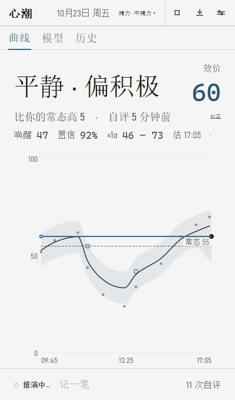
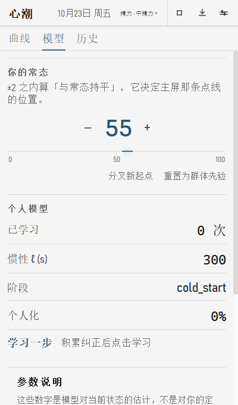
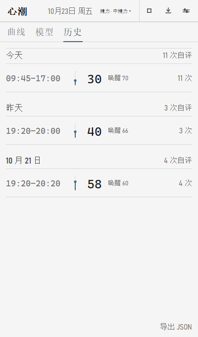
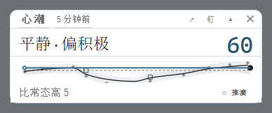
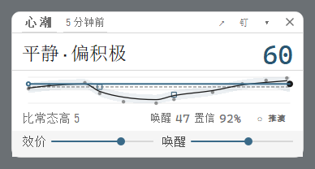
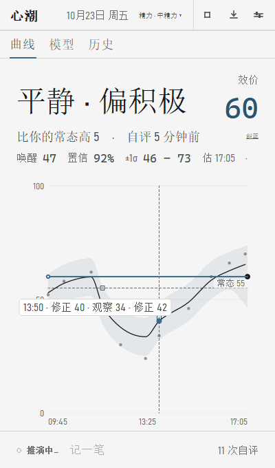
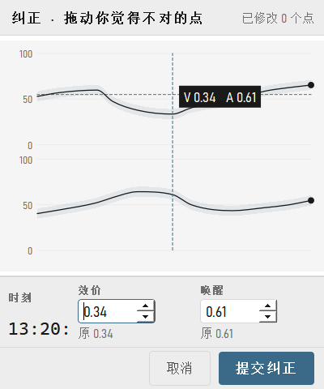
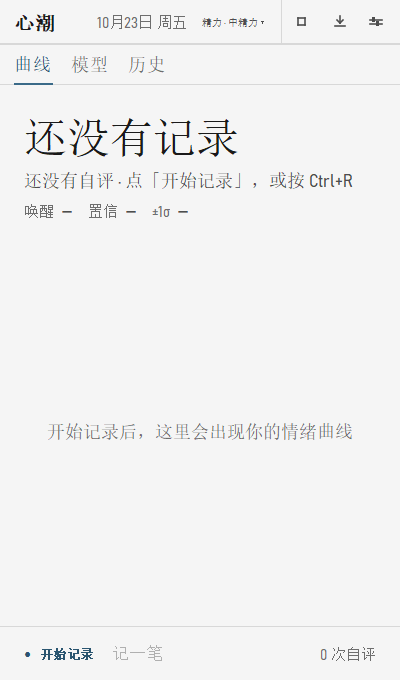
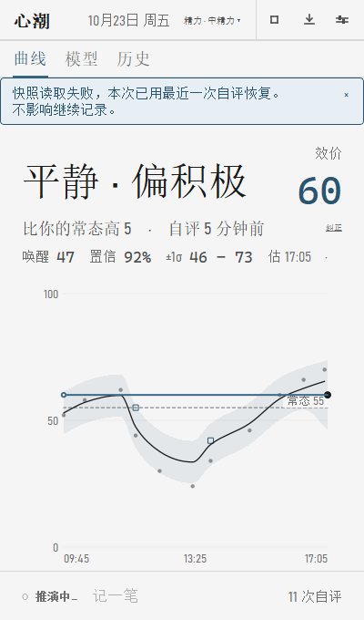
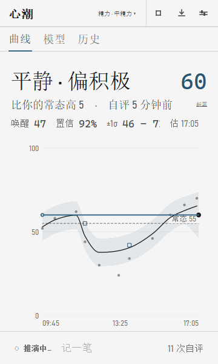

<div align="center">


</div>

# 心潮 EmoWave

**本地优先的个人情绪状态引擎。** 不评分、不催促、不上传。
它把你说过的每一句话，变成一个持续演化的状态估计，并用一条曲线告诉你：
**你现在在哪、你怎么走到这里、接下来可能会怎样。**

- 版本：3.0.0 · Python 3.9+ · PyQt5 5.15 · SQLite
- 788 条测试全绿 · 零云端依赖 · 数据只在本机
- 界面：黑 / 白 / 石墨灰 + 少量低饱和深海蓝

---

## 界面

主屏只回答一个问题：**我现在怎么样。**



- 26px 的状态句是第一眼看到的东西；旁边的「60」是此刻的效价
- 蓝色的**水位线**横贯画面 —— 你在轴上的位置；点线是「常态 55」
- 曲线穿过每一次自评：圆点是你说过的，方框是你改过的，虚线是模型猜的
- 底部只有一行：开始记录 / 记一笔 / 次数

| 模型页 | 历史页 |
|:---:|:---:|
|  |  |
| 常态步进器 + 横向常态尺（±2 内算持平）；个人模型逐行记录 | 按天分组；每行是时间、峰值尺、峰值与次数；点一行展开事件回顾 |

悬浮窗（收起 360×134 / 展开 360×180）：把同一套水位语言压缩到最小。

| 收起 | 展开 |
|:---:|:---:|
|  |  |

---

## 界面设计：为什么长这样

### 水位：位置比分数更像情绪

EmoWave 的模型核心不是「你得了 60 分」，而是「**你比自己的常态高 5**」。
界面照此表达：一条 0–100 的竖轴、一条横贯画面的当前水位、一条标着「常态」的点线。
你看到的是位置，而不是成绩。

### 蓝色只表示「位置」

中性三级灰承担全部结构（正文 15.96:1、次级 7.75:1、极小标签 4.68:1，均达 WCAG AA）。
蓝色 `#3A6A88` 只出现在四个地方：水位线、常态带、记录中的反相底、修正点。
一屏蓝色面积不超过 3% —— 它出现的地方就是「你在哪」。

### 曲线更柔和，但更严谨

相邻两个模型点之间使用**单调三次 Hermite 插值**（Fritsch–Carlson）：

- 穿过每一个模型点，**不改变任何模型值**；
- 每段内不产生新极值 —— **不可能凭空造出一个峰或谷**；
- 斜率限制在 3 倍割线以内，避免过冲。

内核给出的是 Matérn 3/2 后验均值，本身就是光滑函数；`curve_payload` 只在观察时刻采样。
把已知采样点如实连接是**绘制分辨率**问题，不是模型问题。
**没有做**：对观察点平滑、改预测、改方差、为了让曲线好看而移动任何点。

### 常态带：来自已有规则的 ±2

`_diff_from_baseline` 里写着：|差| ≤ 2 视为「与基线持平」。
所以「常态」本来就不是一个点，而是一条区间。主屏画成一条点线 + `常态 55`，
模型页把它放大成一把可调的横尺（浅蓝块就是 ±2），历史页每行再用峰值尺呼应。

---

## 功能

### 记录与自评

- **开始记录 → 记一笔 → 停止记录**：观察只来自你的动作，定时器从不制造数据
- 记录中滑块才出现；停止后界面回到安静的状态，模型继续外推
- `Ctrl+R` 开始/停止，`Ctrl+N` 记一笔

### 曲线

| 元素 | 画法 | 含义 |
|---|---|---|
| 真实观察 | 实心小圆 | 我说的 |
| 模型估计 | 实线 + ±1σ 带 | 模型算的 |
| 未来预测 | 虚线 | 猜的 |
| 用户修正 | 空心方框 | 我改的 |
| 基线 | 点线 + 常态标签 | 我的正常值 |

悬停任意位置可读那一刻的时间、语义与数值：



### 纠正

拖动曲线上的点，或在底部输入框改数值。纠正会作为弱观测参与重拟合，
但**不会被当成真值** —— 它只影响「我相信自己多少」。



### 模型页

- 常态步进器 `− 55 +` 与横向常态尺
- 分叉（把当前状态设为新起点）/ 重置为群体先验
- 已学习次数、惯性 ℓ、阶段、个人化程度；「学习一步」把积累的纠正纳入模型

### 历史页

按天分组的事件清单；点一行展开该事件的回顾与补全入口；可导出 JSON。

### 悬浮窗

置顶小窗，与主窗共享同一个 presenter。收起只留状态、数值与曲线；
展开才出现唤醒、置信与滑杆。**收起不是暂停**，模型照常推进。

---

## 空态与错误态

| 空态 | 错误提示 |
|:---:|:---:|
|  |  |
| 第一次打开：告诉你下一步，而不是显示假曲线 | 数据库/快照失败时说明影响，可关闭，不静默 |

窄窗（360×600）会自动降一档字号并隐藏日期，但**不隐藏功能、不裁字**：



---

## 架构

```
emowave/                零依赖内核（可 pip 安装，不含 PyQt）
  core/domain/          状态、观察、纠正、基线等纯数据
  core/inference/       Matérn 3/2 状态空间、Kalman、RTS、预测
  core/learning/        在线岭回归、收缩先验、Coactive 校准
  core/storage/         SQLite 适配器
presenters/             编排层：唯一持有内核对象的地方
  console_presenter.py  presenter（信号 + 数据契约）
  snapshot_store.py     快照读写与损坏降级
  forecast_logger.py    因果预测快照（评估用）
windows/                纯视图：读 payload、发动作，不碰内核
curve_widget.py         曲线绘制（自绘 + 悬停 + 抽稀 + 缓存）
theme.py                设计令牌与全局 QSS
tools/forecast_eval.py  离线评估：MAE / RMSE（按 horizon）
db.py                   应用层数据库（事件、摘要、状态、预测日志）
main_app.py             桌面入口（400×680，三页）
```

**七条不变量**

1. 内核不依赖第三方库（含 PyQt / numpy）
2. 观察只来自用户动作，定时器只推进时间
3. 时间只有一个来源：`WaveScheduler.now()`（可注入假时钟）
4. 状态常驻：曲线可以消失，模型仍能回答「现在是什么状态」
5. 预测永不变成观察
6. 视图不访问 presenter 私有成员（有测试守着）
7. 曲线五语义不随页面变化

---

## 核心算法

- **状态表示**：`E(t) = [V, A, I, S]`（效价、唤醒、强度、稳定度）
- **平滑**：Matérn ν=3/2 状态空间 ⇔ 因果 Kalman；离线回顾用 RTS 平滑
- **外推**：在**偏差空间**相对你的基线传播，每步叠加过程噪声（越远越不确定）
- **惯性** `ℓ`：情绪回落的半衰期约 `0.969·ℓ`
- **基线**：分层先验向精力人群收缩；支持 nudge / fork / reset
- **校准**：拖动纠正 = Coactive 改进信号；在线岭回归更新参数
- **评估**：`forecast_log` 记录因果预测，7 天后可算真实 MAE / RMSE

> **精度尚未验证。** 目前没有 7 天以上的真实使用数据，README 不会声称「预测很准」。
> 评估底座已就绪：`python -m tools.forecast_eval`。

---

## 隐私

- 所有数据在 `~/.emowave/emowave.db`（SQLite），不上传、不联网
- 无账号、无遥测、无崩溃上报
- 悬浮窗与主窗共享同一进程，没有额外端口或服务
- 导出是手动 JSON，不自动同步

---

## 快速开始

```bash
# 运行
python main_app.py            # 或双击 run_emowave.bat

# 测试
python -m pytest -q           # 788 passed

# 内核 CLI（不需要 GUI）
python -m emowave.cli --help

# 预测评估（需要至少几天的真实使用数据）
python -m tools.forecast_eval --help
```

**Windows 提示**：若 `python` 指向 Microsoft Store 占位符（退出码 49），
请用真实解释器，例如
`C:\Users\<you>\AppData\Local\Programs\Python\Python39\python.exe`。

**备份**：关闭应用后复制 `~/.emowave/emowave.db` 即可；恢复时覆盖回去。
数据库损坏时应用会降级启动并提示，不会静默丢数据。

---

## 质量

- **788 条测试**：内核数学、presenter 契约、UI 交互、数据库、评估、架构护栏
- **6 条架构护栏**：零依赖内核、无孤儿模块、入口可导入、白名单有效、LOC 预算、无重复定义
- **视觉验收靠截图**：offscreen 平台不渲染文字，所有界面截图都在 Windows 平台插件下拍摄
- 颜色对比度有脚本实测（`docs/ui-exploration-01/contrast_report.py`），不靠肉眼

---

## 当前状态与已知限制

| 项 | 状态 |
|---|---|
| 主屏 / 模型页 / 历史页 / 悬浮窗 | 已按新语言重排 |
| 深色模式 | 未做（蓝色在暗底需重新校准） |
| 预测的可见性 | 日尺度下 10 分钟只占约 2% 宽度，用文字「预测 N 分钟」补足 |
| 拖动水位线设效价 | 原型验证过，生产仍用记录时的滑杆 |
| 125% / 150% 缩放 | 未逐一核对 |
| 模型精度 | 未验证，等 7 天以上真实数据 |
| 历史页行内回顾 | 点行后在顶部展开（不是就地展开） |

---

## 文档地图

| 文档 | 内容 |
|---|---|
| [`docs/UI_PREFLIGHT_视觉传达与UI设计调研.md`](docs/UI_PREFLIGHT_视觉传达与UI设计调研.md) | 开工前的视觉调研与 PyQt 坑位 |
| [`docs/refactor-v5/`](docs/refactor-v5/) | v5 六个阶段的实施记录与 ROADMAP |
| [`docs/ui-exploration-01/`](docs/ui-exploration-01/) | A/B 换色探索、对比度实测、公平性检查 |
| [`docs/ui-exploration-02/`](docs/ui-exploration-02/) | 两套结构方案（地平线 / 水位）与灰度原型 |
| [`docs/ui-exploration-03/`](docs/ui-exploration-03/) | 定稿方向的设计说明、落地记录与可运行原型 |
| [`docs/交接文档.md`](docs/交接文档.md) | 目录、数据契约、接手顺序 |

---

## 许可

见 [LICENSE](LICENSE)。
